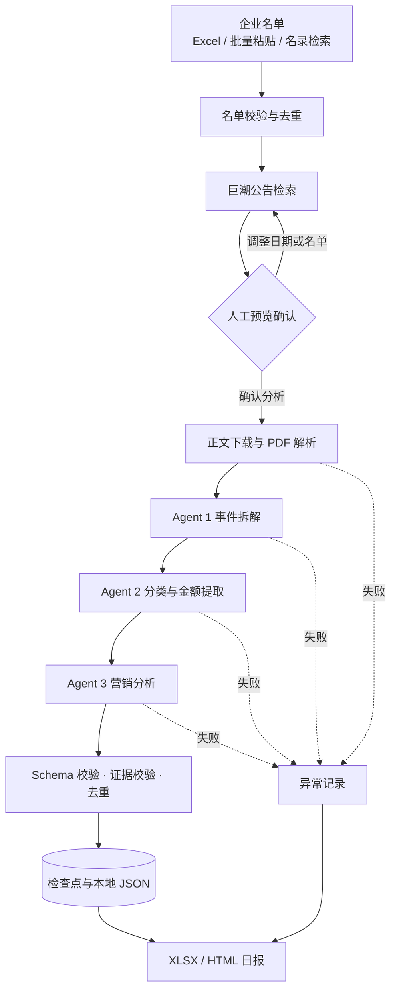

# AI 工程课程项目申报书

| 项目 | 内容 |
|---|---|
| 项目名称 | 上市公司商机雷达（Listed Company Opportunity Radar） |
| 项目类型 | AI 工程应用 · 多 Agent 信息处理系统 |
| 团队名称 | 掘金者小组 |
| 团队成员 | 【姓名 / 学号 / 分工，待补充】 |
| 指导教师 | 【待补充】 |
| 课程名称 | AI 工程 |
| 申报日期 | 2026 年 11 月 |

> 本申报书依据项目现有的《需求文档》《SPEC.md》《TECH_DESIGN.md》、代码实现与真实公告验收批次整理。文中【】为需要团队补充的信息；第 8 节的数据来自已保存的验收批次，不代表模型准确率已经达标。

## 一、项目摘要

银行对公业务每天都要面对大量上市公司公告。采购、中标、投资、融资、资金管理等信息都写在公告里，但公告数量多、篇幅长、版式复杂，客户经理很难在第一时间读完，更难把“某公司拟投资 10 亿元建厂”转换成“项目贷款、结算、供应链金融”的具体跟进动作。

本项目把公开公告加工成一条可核验的商机流水线：用户导入目标企业名单，系统从巨潮资讯网检索公告，经人工预览确认后下载并解析正文，再由三个职责分离的 AI Agent 依次完成事件拆解、商机分类与金额提取、银行营销分析，最后输出带原文证据的 XLSX 与 HTML 日报。系统以“一条独立商机”为数据单位，一份公告可以拆出多条线索；所有金额、事件和营销建议都能回到公告原文，采集失败、解析失败和分析失败分别记录，不会被误报成“没有商机”。

目前项目已完成端到端 MVP，并在 20 家上市公司、32 篇真实公告上跑通全流程，产出 47 条结构化商机。下一阶段重点不是继续堆功能，而是建立质量评估集，把“能跑通”推进到“可判断好坏”。

## 二、背景与问题

### 2.1 业务背景

银行对公营销需要持续跟踪上市公司的六类经营行为：采购与招标、销售与中标、投资与并购、新增融资、闲置资金管理、重大经营变化。这些行为大多会通过公告披露，且往往对应明确的金融需求：

- 重大投资项目 → 项目贷款、银团、资金结算
- 中标或大额销售合同 → 供应链金融、保理、票据
- 并购与增资 → 并购贷款、投行顾问、募集资金监管
- 新增授信、债券、租赁 → 授信管理、债券承销、同业合作
- 闲置资金与理财 → 结构性存款、现金管理

### 2.2 现有做法的三个断点

| 环节 | 现状 | 断点 |
|---|---|---|
| 信息获取 | 巨潮、交易所网站、Wind、舆情工具 | 公告分散，检索靠人工；全市场扫描噪声大 |
| 信息理解 | 人工阅读 PDF，或用通用大模型做摘要 | 摘要不区分“项目总投资”“拟申请授信”“实际融资”；一份公告里的多个事项被混成一段 |
| 业务转化 | 客户经理凭经验判断 | 缺少产品映射、跟进动作和待核实清单；结论无法回溯到原文 |

通用大模型可以“总结公告”，但很难稳定回答三个业务问题：这份公告里到底有几个独立事项？每个事项对应哪类银行机会、金额口径是什么？下一步该找谁、核实什么？而这三问，正是商机情报的价值所在。

### 2.3 问题定义

本项目要解决的问题可以写成一句话：

> 在不伪造事实的前提下，把非结构化的上市公司公告，批量转换为可追溯、可筛选、可执行的银行商机线索。

“不伪造事实”不是一句口号，而是系统约束：AI 提取的每条证据必须是原文逐字片段；未披露金额必须为 `null` 并标记未披露；采集失败必须显示为失败，不能输出空结果冒充“无商机”。

## 三、项目创意与核心主张

项目的创意不在于“用大模型读 PDF”，而在于把一条业务分析链路拆成可验证的工程结构。具体是三个设计选择。

### 3.1 以“独立商机”而不是“公告”为数据单位

一份公告可能同时包含对外投资、关联交易、授信申请等多件事。如果以公告为单位输出，后续筛选、统计和跟进都会失真。系统把公告拆成 0 到 N 个独立事件，每个事件生成一条商机，共享公告来源，但拥有独立的事件摘要、类别、金额和营销建议。

这条规则同时约束了反向错误：同一资金事项不能因为对应多个银行产品就被拆成多条商机，避免金额被重复计算。

### 3.2 三段式 Agent，而不是一个“大提示词”

把“读懂公告”“归类提数”“给营销建议”混在一个提示词里，看似省事，实际有三个问题：错误无法定位、提示词无法单独迭代、输出结构容易互相污染。项目采用固定顺序的三个 Agent：

1. **事件拆解**：只负责判断这份公告有哪些独立事项，以及哪些值得继续分析。
2. **分类与提取**：只负责把单个事件归入七类，并抽取金额、交易对象、项目名称和证据。
3. **营销分析**：只对采购、投资并购、融资新增、增值四类重点商机生成产品与动作建议，其余三类保留基础识别。

每个 Agent 的输入输出都是强类型 JSON，中间结果单独落盘。这样某一篇公告分析失败时，可以定位到具体阶段，也可以在不重跑前序步骤的情况下重试。

### 3.3 证据先行，模型不能“自说自话”

系统对模型输出做三道硬校验：

- 证据片段必须能在公告正文中逐字匹配（忽略空白），否则报 `EVIDENCE_MISMATCH`；
- 金额的 `original_text` 必须能在原文中找到，否则报 `AMOUNT_EVIDENCE_MISMATCH`；
- 类别必须落在七类枚举内，否则报 `UNKNOWN_CATEGORY`。

校验不通过时，系统宁可把这篇文章标为分析失败，也不把无法核实的结论写进日报。这是本项目与“让模型自由发挥”的路线最本质的区别。

## 四、目标用户与典型场景

### 4.1 目标用户

| 角色 | 关注点 | 系统提供 |
|---|---|---|
| 分行公司金融部营销管理人员 | 今天有哪些企业值得跟进 | 按类别汇总的商机日报、企业清单、异常提示 |
| 客户经理 | 这家企业发生了什么、我能做什么 | 事件摘要、金额与口径、潜在产品、建议动作、待核实事项 |
| 产品经理 | 哪类需求在集中出现 | 七类商机分布、重点客户清单 |
| 授信审批与风险人员 | 信息是否可信 | 原文证据、页码、公告链接、分析状态 |

### 4.2 典型使用场景

T 日 8:30，客户经理打开前一日商机日报：

1. 日报显示本次扫描 20 家企业、32 篇公告、47 条商机，其中 5 篇因证据校验未通过被列为分析失败。
2. 客户经理按“投资并购类”筛选，看到某公司拟建设新生产基地，项目总投资 10 亿元，另披露拟申请银行贷款 6 亿元。
3. 点开详情，能看到两条原文证据、公告链接、建议动作“了解项目建设进度与融资安排”，以及待核实事项“贷款审批及实际提款情况”。
4. 客户经理带着这些信息给企业打电话，而不是从零开始读公告。

原来需要半天浏览的公告，被压缩成十分钟的定向阅读。系统不替代客户经理做决策，但把“读什么、为什么读、读完问什么”准备好了。

## 五、同类方案与差异化

| 方案类型 | 代表 | 优势 | 不足 | 本项目差异 |
|---|---|---|---|---|
| 金融终端 | Wind、同花顺 | 数据全、更新快 | 以查询和行情为主，商机需人工二次加工 | 直接输出业务动作与产品映射 |
| 企业信息平台 | 企查查、天眼查 | 工商与风险信息完整 | 公告解读浅，缺少营销视角 | 面向银行对公营销场景建模 |
| 舆情与监测系统 | 舆情通、鹰眼 | 覆盖面广、告警及时 | 偏向负面舆情，正向外向型商机弱 | 聚焦采购、投资、融资等正向机会 |
| 通用大模型直接总结 | ChatGPT、DeepSeek 网页版 | 上手快、语言能力强 | 无结构、无证据校验、无法批量留痕 | 多阶段流水线、统一 Schema、可追溯 |
| 传统 RPA + 关键词规则 | 自建脚本 | 成本低、可控 | 语义理解弱，金额与事件拆解困难 | 规则负责校验，模型负责理解 |

差异化的核心不是“模型更强”，而是“工程约束更完整”：有统一数据模型、有失败语义、有检查点、有成本控制、有可复核的证据链。这些恰好是 AI 应用从演示走向业务使用的门槛。

## 六、系统方案

### 6.1 总体架构



系统是单机 Python 应用：Streamlit 负责交互，核心业务由普通 Python 服务与模块实现，本地文件保存公告、中间结果和报告。MVP 阶段不引入数据库、消息队列和容器集群，降低部署与调试成本；领域模型与 Service 层保持独立，后续可平滑替换为 FastAPI 或数据库存储。

### 6.2 端到端流程

1. **名单输入**：支持 Excel 上传、批量粘贴、企业名录检索三种入口，统一追加到已选名单。股票代码补齐前导零，重复代码跳过，名称歧义必须由用户确认。
2. **名单校验**：检查代码格式、空值、重复和数量，展示有效行、重复行、待确认行与错误行，问题明细可下载。
3. **公告检索**：按企业逐一查询巨潮公告元数据，默认扫描上一工作日至昨天，使用北京时间与中国内地交易日历。此阶段不下载正文、不调用模型。
4. **人工确认**：进入 `awaiting_review`，用户可预览公告标题、企业、日期和原文链接，调整分析时间预算后确认。确认后才进入正文下载与模型分析，避免为无关公告付费。
5. **正文解析**：下载 PDF 并用 PyMuPDF 提取文本，保存原始文件与文本，解析失败单独记录。
6. **三阶段分析**：逐篇公告执行 Agent 1 → 2 → 3，每个阶段结果原子写入检查点。
7. **校验与去重**：Pydantic 校验结构，逐字校验证据，按公告内事件相似度和证据重合度去重。
8. **报告生成**：同一批 `Opportunity` 数据生成 XLSX 与独立 HTML，包含明细、统计、异常摘要和原文链接。

### 6.3 Agent 设计

| Agent | 职责 | 输入 | 输出 | 关键约束 |
|---|---|---|---|---|
| Agent 1 事件拆解 | 识别公告中的独立业务事项，判断是否值得继续分析 | 公告 ID、标题、正文 | `EventExtractionResult`，0..N 个事件 | 同一事项在标题、提示、正文、附件中重复出现只能算一个事件；程序性内容标记为不分析 |
| Agent 2 分类与提取 | 七类归类，抽取金额、币种、金额类型、交易对象、项目名称 | 公告、单个事件、原文 | `OpportunityDraft` | 类别必须命中枚举；金额口径不得混用；未披露金额用 `null` + `undisclosed=true` |
| Agent 3 营销分析 | 生成潜在银行产品、营销方向、建议动作、待核实事项 | 结构化商机草稿、原文 | `MarketingAnalysis` | 仅四类重点商机深度分析；推断只能写入营销字段，不能写成事实 |

三个 Agent 共用同一个可配置的 OpenAI 兼容模型客户端，通过环境变量设置 `LLM_API_KEY`、`LLM_BASE_URL`、`LLM_MODEL`。换模型不需要改业务代码。

### 6.4 统一数据模型

所有下游产物都从同一个 `Opportunity` 模型生成，Excel 和 HTML 不各自解析模型输出：

```json
{
  "opportunity_id": "ann_xxx_evt_1",
  "announcement_id": "ann_xxx",
  "stock_code": "000001",
  "company_name": "示例上市公司",
  "publish_date": "2026-11-06",
  "announcement_title": "关于投资建设项目的公告",
  "category": "投资并购类",
  "subcategory": "项目投资",
  "event_summary": "拟建设新的生产基地",
  "amount": {
    "value": 1000000000,
    "currency": "CNY",
    "type": "项目总投资",
    "original_text": "项目总投资10亿元",
    "undisclosed": false
  },
  "other_amounts": [
    {
      "value": 600000000,
      "currency": "CNY",
      "type": "拟申请银行贷款",
      "original_text": "拟申请银行贷款6亿元",
      "undisclosed": false
    }
  ],
  "bank_products": ["项目贷款", "资金结算"],
  "marketing_direction": "项目融资及结算业务",
  "suggested_action": "了解项目建设计划和融资安排",
  "evidence": [{"text": "项目总投资10亿元", "source_page": 2}],
  "pending_verification": ["贷款审批及实际提款情况"],
  "source_url": "https://example.com/demo",
  "analysis_status": "completed"
}
```

示例中的公司、金额和链接均为演示数据。`amount.value` 统一为数值，未披露时为 `null` 而不是 0；`other_amounts` 保留同一事件中的其他口径金额。

### 6.5 技术栈

| 模块 | 技术 | 作用 |
|---|---|---|
| 界面 | Streamlit | 名单输入、任务状态、结果筛选、报告下载 |
| 开发语言 | Python 3.10+ | 业务逻辑与编排 |
| 公告采集 | httpx | 巨潮公告查询与 PDF 下载 |
| 正文解析 | PyMuPDF | 提取文本型 PDF |
| 结构化校验 | Pydantic 2 | 领域模型、Agent 输出与状态校验 |
| Agent 编排 | Python 函数式工作流 + 线程池 | 固定顺序执行，公告级并发 |
| 模型调用 | OpenAI 兼容客户端 | 统一超时、重试与 JSON 解析 |
| 交易日历 | exchange-calendars | 默认扫描区间计算 |
| Excel | openpyxl | 商机明细与扫描概览 |
| HTML | Jinja2 | 独立日报模板 |
| 测试 | pytest | 单元、适配器与端到端测试 |

## 七、AI 工程关键设计与课程知识点映射

这一节回答“为什么这是一个 AI 工程项目，而不是一个调用 API 的脚本”。

### 7.1 结构化输出与失败语义

模型返回的是自然语言概率分布，不是数据库记录。系统要求每个 Agent 输出 JSON，并立即用 Pydantic 校验；校验失败不会用默认值补齐，而是记录 `SCHEMA_VALIDATION_FAILED`，保留检查点并继续处理其他公告。

任务状态机为：

```text
queued → collecting → awaiting_review → analyzing → exporting
                                              ├→ completed
                                              └→ completed_with_errors
任意阶段异常 → failed
```

`completed_with_errors` 仍允许下载报告，但报告必须列出异常摘要；`failed` 才表示任务整体不可用。采集失败、正文解析失败、单篇分析失败分别计数，避免“0 条商机”被误解为“没有机会”。

### 7.2 事实可追溯：逐字证据校验

这是系统最关键的工程约束。实现上把正文和证据都去掉空白字符后做子串匹配：

```python
source = re.sub(r"\s+", "", text)
if any(re.sub(r"\s+", "", e.text) not in source for e in evidence):
    raise EvidenceError("EVIDENCE_MISMATCH")
```

金额额外校验 `original_text`，类别额外校验枚举。模型可以改写摘要，但不能改写证据；一旦改写，系统拒收。这样日报里的每个结论都能被人工快速复核。

### 7.3 多事件拆解与去重

公告常在标题、重要内容提示、正文和附件中重复同一件事。如果直接让模型拆分，容易产出多条重复商机，导致金额被重复统计。

系统的处理是两层：

1. **提示词层**：明确“同一事项、同一交易、同一组数字只能输出一个事件”，程序性内容标记为不分析。
2. **程序层**：事件摘要相似度达到 0.82，或证据集合的 Jaccard 重合度达到 0.5，即判为重复；商机层再按摘要 0.85 和同类别证据重合度去重，重复时保留金额更完整、证据更多的一条。

去重不是可选的“美化”，而是保证统计口径正确的前置条件。

### 7.4 长流程的成本控制与恢复

一次扫描可能持续几十分钟，涉及几十次模型调用。项目用四个机制控制风险：

- **两阶段确认**：先只检索公告元数据，人工确认后才下载正文和调用模型。没有公告的企业不产生模型费用。
- **时间预算**：单篇默认 600 秒、整批默认 28800 秒，可在页面调整；底层 HTTP 超时独立生效。
- **检查点**：每篇公告的 Agent 1/2/3 结果实时写入 `result.json`，任务中断后从检查点继续，成功项不重跑。
- **失败重试**：采集失败、正文失败、分析失败可分别重试；重试前把旧结果归档到 `history`，不覆盖验收依据。

### 7.5 并发、原子写入与可观测性

- 公告级并发默认 2 个 worker，企业采集串行且相邻企业间隔 0.5 秒，兼顾速度与来源站压力。
- 所有 JSON 和报告先写临时文件再原子替换，避免页面读到半成品。
- 每条错误带作用域、错误码、公告 ID、阶段、异常类型和处理建议；日志不打印密钥、完整公告正文或完整模型响应。
- API Key 只从环境变量读取，`.env` 不进入版本库。

### 7.6 课程知识点映射

| 课程能力 | 项目中的落点 |
|---|---|
| 需求工程 | 15 项需求决策、PRD、SPEC、明确的不做清单 |
| 提示词工程 | 三个 Agent 的角色边界、证据逐字引用、金额口径约束 |
| 结构化输出 | Pydantic 模型、枚举约束、Schema 校验、错误码 |
| Agent 编排 | 固定顺序工作流、中间结果落盘、失败隔离与重试 |
| 评测意识 | 离线 fixture 验收、真实批次留档、下一阶段人工标注评估集 |
| 可观测性 | 状态机、阶段进度、分类错误统计、异常明细 |
| 成本与延迟 | 两阶段确认、时间预算、公告级并发、检查点复用 |
| 安全与合规 | 公开信息边界、密钥管理、日志脱敏、未披露金额不猜测 |
| 工程化交付 | Git 分支与提交规范、pytest、离线验收脚本、部署文档 |

## 八、当前进展与验证

### 8.1 已实现功能

| 模块 | 状态 | 说明 |
|---|---|---|
| 名单输入 | 已完成 | Excel、批量粘贴、名录检索；代码补零、去重、歧义确认；取消 50 家硬上限 |
| 公告采集 | 已完成 | 巨潮分页查询、来源链接、失败记录、企业级检查点 |
| 正文解析 | 已完成 | PyMuPDF 提取文本；失败写入 `DOCUMENT_PARSE_FAILED` |
| 三 Agent 分析 | 已完成 | 真实模型与 Mock 演示双模式；证据、金额、类别校验 |
| 事件与商机去重 | 已完成 | 摘要相似度 + 证据重合度；同一公告内合并重复事项 |
| 两阶段确认 | 已完成 | 检索 → 预览 → 确认 → 分析；支持调整时间预算 |
| 检查点与恢复 | 已完成 | 公告级结果落盘；中断续跑；历史任务查看 |
| 失败重试 | 已完成 | 采集/解析失败重试、单篇分析失败重试、旧结果归档 |
| 报告导出 | 已完成 | XLSX 商机明细 + 扫描概览；独立 HTML 日报 |
| 结果浏览 | 已完成 | 企业、类别、分析状态筛选；证据、页码、待核实事项、来源链接 |
| 异常展示 | 已完成 | 阶段、类型、HTTP 状态、处理建议；不输出原始模型响应或密钥 |

### 8.2 代码与测试规模

- 61 个 Python 文件，约 2450 行（含应用、核心模块、采集、解析、Agent、导出、脚本与测试）。
- 22 个 pytest 测试模块，覆盖日期计算、名单校验、采集适配器、文档解析、Agent 校验、事件去重、检查点、失败重试、报告导出与端到端流程。
- 提供 `scripts/acceptance.py` 离线验收脚本，使用临时目录与固定数据，不依赖网络和真实模型。

需要说明的是，项目依赖 Pydantic 2，而当前本地 Anaconda 环境仍是 Pydantic 1.10，直接运行 pytest 会在收集阶段报导入错误。这是环境问题，不是测试失败；结项前会在独立虚拟环境中重跑并记录结果。本文不把“测试已全部通过”写成既成事实。

### 8.3 真实公告验收结果

验收使用 2025-12-01 至 2025-12-05 的历史窗口、20 家上市公司名单，连接巨潮真实公告与真实模型，结果保存在 `data/final_acceptance/`。

| 指标 | 结果 |
|---|---|
| 企业数 | 20 |
| 采集公告数 | 32 |
| 生成商机数 | 47 |
| 采集失败 | 0 |
| 正文解析失败 | 1 |
| 单篇分析失败 | 5 |
| 任务终态 | `completed_with_errors` |
| 报告 | XLSX 与 HTML 均已生成 |

商机类别分布为：报告类 6、其他类 32、投资并购类 5、采购类 2、融资新增类 1、销售类 1。

这组数据说明三件事：

1. 真实公告可以稳定采集，32 篇公告没有出现采集失败。
2. 端到端链路可以产出报告，部分失败不影响整体交付。
3. 分类明显偏向“其他类”，说明提示词和类别边界仍需优化，这是下一阶段质量评估的重点，而不是可以忽略的细节。

5 篇分析失败的原因包括结构校验失败、金额证据不匹配和证据不匹配。这些失败是系统的保护机制在起作用：无法核实的输出被拒收，而不是被伪装成商机。同一窗口的三次真实批次分别产出 65、62、47 条商机，差异来自模型非确定性和去重规则调整，也进一步说明需要固定评估集来衡量稳定性。

### 8.4 当前限制

| 限制 | 影响 | 计划 |
|---|---|---|
| 扫描件 PDF 无 OCR | 部分公告无法提取正文 | 明确报错；OCR 列为后续增强 |
| 分类偏斜 | “其他类”占比过高 | 补充类别定义与少样本示例，建立评估集 |
| 未量化准确率 | 无法判断模型好坏 | 人工标注 100 篇公告，计算分类与金额一致率 |
| 单机部署 | 无多用户与权限 | MVP 明确不做，后续再评估 |
| 无定时调度 | 需手动触发 | 明确不做，避免范围蔓延 |
| 跨公告语义合并 | 同一事件多公告披露时可能重复 | 当前按公告 ID 去重，语义级合并留待后续 |

## 九、实施计划

以 2026 年 11 月 12 日为起点，按 6 周安排；具体结项日期以课程要求为准。

| 阶段 | 时间 | 主要任务 | 交付物 | 验收方式 |
|---|---|---|---|---|
| 环境与回归 | 第 1 周 | 建虚拟环境、安装 Pydantic 2、重跑 pytest、修复环境导致的失败 | 可复现的测试记录 | 测试全绿或失败项有明确说明 |
| 评估集建设 | 第 2 周 | 选取 100 篇公告，人工标注事件数、类别、金额口径、证据 | 标注集与评估脚本 | 双人复核，分歧记录 |
| 质量迭代 | 第 3 周 | 针对分类偏斜、金额口径、重复事件调整提示词与规则 | 新版本提示词与对比结果 | 关键指标较基线提升 |
| 小范围试用 | 第 4 周 | 邀请同学模拟客户经理完成 3 次日报阅读任务 | 试用反馈与问题清单 | 任务完成率、可理解性评分 |
| 收尾与部署 | 第 5 周 | 报告样式、异常提示、部署、演示脚本 | 线上可访问版本 | 端到端演示无阻断 |
| 答辩准备 | 第 6 周 | 整理结项报告、架构图、演示视频 | 结项材料 | 按课程模板检查 |

计划遵循“先验证高风险环节”的顺序：采集与解析已经跑通，当前最大风险转为输出质量和评估能力，因此把评估集放在功能开发之前。

## 十、预期成果与考核指标

### 10.1 交付物

1. 可运行的 Streamlit 应用与完整源码。
2. 20 家以上企业的真实公告样例报告（XLSX + HTML）。
3. 100 篇公告的人工标注评估集与评估脚本。
4. pytest 测试套件与离线验收脚本。
5. 需求、规格、技术设计、运维说明与结项报告。
6. 5 至 8 分钟演示视频与答辩材料。

### 10.2 指标

| 维度 | 指标 | 结项目标 | 验证方式 |
|---|---|---|---|
| 功能 | MVP 验收场景 | 9 项全部通过 | 按 SPEC 逐项演示 |
| 稳定性 | 可访问公告的采集成功率 | ≥ 95% | 真实批次统计 |
| 稳定性 | 文本型 PDF 解析成功率 | ≥ 90% | 真实批次统计 |
| 可追溯 | 证据逐字匹配率 | 100% | 系统强制校验，失败即拒收 |
| 质量 | 商机分类抽检准确率 | ≥ 80% | 100 条人工标注 |
| 质量 | 金额与原文一致率 | ≥ 90% | 人工核对金额与口径 |
| 效率 | 20 家企业单批处理时间 | ≤ 30 分钟 | 任务耗时统计 |
| 成本 | 单篇公告模型成本 | ≤ 1 元 | 按实际账单折算 |
| 体验 | 试用任务完成率 | ≥ 80% | 3 次模拟阅读任务 |

这些是结项目标，不是当前已达成的结果。分类准确率的分子分母、标注口径和分歧处理方式会在评估集文档中写清楚，避免“看起来差不多”的主观判断。

## 十一、风险与应对

| 风险 | 可能性 | 影响 | 应对 |
|---|---|---|---|
| 巨潮接口或页面结构变化 | 中 | 采集失败，链路中断 | 适配器隔离；保留失败日志；准备按公告 ID 补采 |
| 扫描件与复杂版式解析失败 | 高 | 单篇无正文 | 明确报错并可重试；不引入 OCR 作为 MVP 承诺 |
| 模型编造证据或金额 | 中 | 输出不可信 | 逐字证据校验、金额原文校验、校验失败拒收 |
| 分类偏斜与提示词漂移 | 高 | 日报价值下降 | 固定评估集；提示词版本化；错误案例分析 |
| 模型费用或延迟超预期 | 中 | 批次无法完成 | 两阶段确认、时间预算、并发限制、检查点续跑 |
| 公开数据使用边界 | 低 | 合规争议 | 只处理公开公告；不接入银行内部客户资料；不绕过访问控制 |
| 进度延期 | 中 | 结项材料不完整 | 每周检查里程碑；功能做减法，优先保证评估与演示 |

## 十二、团队分工

| 角色 | 姓名 | 主要职责 |
|---|---|---|
| 项目负责人 / 产品 | 【待填】 | 需求边界、验收标准、进度与对外沟通 |
| 采集与解析 | 【待填】 | 巨潮适配器、PDF 解析、来源追溯、异常分类 |
| Agent 与提示词 | 【待填】 | 三阶段提示词、结构化输出、证据校验、去重规则 |
| 应用与导出 | 【待填】 | Streamlit 页面、任务状态、XLSX/HTML 报告 |
| 测试与评估 | 【待填】 | pytest、离线验收、标注集、指标统计 |

协作方式沿用仓库现有规范：功能在独立分支开发，提交信息使用 `feat:`、`fix:`、`test:`、`docs:` 前缀；行为变更前先对照 `SPEC.md`，验收批次保留原始数据，不用新结果覆盖旧结果；密钥与真实客户信息不进入版本库。

## 十三、资源与预算

| 资源 | 需求 | 说明 |
|---|---|---|
| 开发环境 | 普通笔记本，Python 3.10+ | 单机运行，无需 GPU |
| 模型服务 | OpenAI 兼容 API | 默认示例为 DeepSeek，可替换 |
| 部署 | Streamlit Community Cloud 或本地 | 公开演示用 |
| 数据 | 巨潮公开公告 | 无采购成本 |
| 存储 | 本地文件，单批次约数十 MB | 公告 PDF 与中间 JSON |

按 20 家企业、5 个交易日估算，单批约 32 篇公告、47 个事件、约 120 次模型调用；每篇公告正文约数千字，单批输入 token 在百万量级。按当前国产模型价格，单批成本约几元到十几元，100 次实验在数百元以内。实际费用以账单为准，页面会在分析前展示时间预算，避免误触发大批量调用。

## 十四、项目创新点

1. **业务语义建模**：不是通用摘要，而是把公告映射到七类银行商机，并把“项目总投资”“拟申请授信”“实际融资”拆成不同金额口径。
2. **证据闭环**：每条结论必须能逐字回到原文，校验不通过就拒收，模型没有“编造的自由”。
3. **事件级数据单位**：一份公告拆成多条独立商机，同时约束同一资金事项不被多产品重复计算。
4. **成本可控的人机协同**：先检索、再确认、后分析，把模型调用放在人工判断之后。
5. **可恢复的长流程**：公告级检查点、分阶段重试、旧结果归档，让几十分钟的任务可以中断续跑。
6. **统一数据资产**：Excel、HTML、后续评分与 CRM 对接都从同一个 `Opportunity` 模型生成，避免重复建设。

## 附录

### A. 项目结构

```text
app.py                  # Streamlit 页面
core/                   # 模型、校验、日历、存储、任务与编排
collectors/cninfo.py    # 巨潮公告采集
parsers/                # PDF / HTML 正文解析
agents/                 # 事件拆解、分类提取、营销分析
exporters/              # XLSX 与 HTML 导出
tests/                  # pytest 测试
scripts/                # 离线验收、真实验收、诊断与恢复
data/                   # 名单、公告、结果、报告
```

### B. 术语

| 术语 | 含义 |
|---|---|
| 公告（Announcement） | 上市公司在巨潮披露的原始文件，系统保存元数据、PDF 与正文 |
| 事件（Event） | 公告中的一个独立业务事项，一份公告可含 0..N 个 |
| 商机（Opportunity） | 事件经过分类、金额提取和营销分析后的结构化线索 |
| 检查点（Checkpoint） | 单篇公告的分析结果文件，用于续跑与失败重试 |
| 演示模式 | 使用 Mock Agent，只验证流程，不产生真实分析结论 |
| 真实模式 | 调用配置的大模型，产生费用，结果需人工复核 |

### C. 参考资料

- 项目《需求文档》MVP PRD v1.0
- `SPEC.md`：接口契约、数据模型、状态与错误语义
- `TECH_DESIGN.md`：架构、存储、去重与测试策略
- `OPERATIONS.md`：使用、验收、故障处理
- 巨潮资讯网公开公告数据
- Pydantic、Streamlit、PyMuPDF、openpyxl、Jinja2 官方文档
